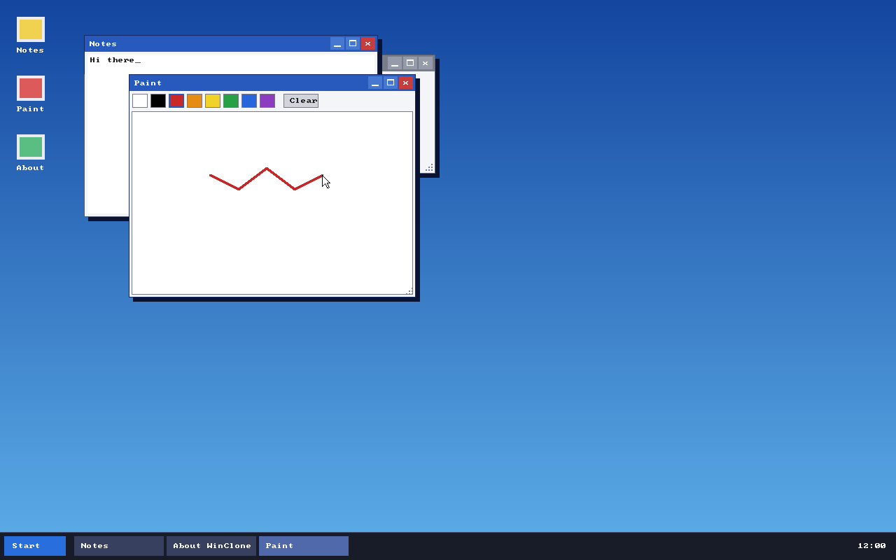

# WinClone

A from-scratch x86-64 operating system with a Windows-style desktop as the goal.
It has its own UEFI loader and kernel and, eventually, its own installer, windowing
system, shell and apps. No code or assets from Microsoft Windows or any other OS are used.

## Status

Boots under QEMU/UEFI. Working today: UEFI loader, higher-half kernel, physical memory
manager, paging, heap, GDT/IDT, PIC and timer, preemptive scheduler with stack guards,
a framebuffer graphics layer (pixels, rectangles, gradients, 8x8 text, clip rectangles),
interrupt-driven PS/2 keyboard and mouse (IRQ layer, 1 kHz PIT timer, RTC clock, idle via
`hlt`), and a window manager with a desktop shell:
overlapping windows with z-order and focus, move, resize, minimize, maximize and close,
a taskbar with one button per window and a real-time clock, a Start menu, desktop icons
(double-click to launch), and dirty-rectangle repainting. Native AHCI/SATA and NVMe drivers, MBR/GPT partition scan and FAT16/FAT32 (long names,
read/write/mkdir/delete) back the Files explorer and Notes open/save (both ordinary user programs). An in-kernel GPT writer
and FAT32 formatter power **Setup**, which installs WinClone onto a disk (GPT + ESP +
data partition + boot files) that then boots on its own. Apps: Files, Notes, Paint and
About (user programs in `\APPS`) and Setup.



## Roadmap

1. Build and boot on Windows 11 (done, see `INSTALL.md`)
2. UEFI GOP framebuffer and text drawing (done); "Console" window in the Start menu with the kernel log and a command prompt (done: help, ls, cd, cat, run, mem, ...)
3. Keyboard and mouse input (PS/2 interrupt-driven, and USB keyboards and mice on xHCI ports, done; hubs and hot plug done (devices found while running, a toast tells you; the volumes are remounted); mouse wheel done (PS/2 IntelliMouse and USB; Console, Notes and Files scroll, programs get `EV_WHEEL`); USB 1.x/2.x-only controllers (EHCI/OHCI/UHCI) still to do), timer and clock (done)
4. Syscalls and user mode (done: processes with their own address spaces, file and window syscalls, Notes as a user program; see `docs/SYSCALL_PLAN.md`); user-space library and ELF loader done (programs are ELF64 executables, see `docs/SYSCALL_PLAN.md`); a high-half kernel still to do
5. Storage and filesystem (AHCI, NVMe, FAT16/FAT32 done, see `docs/STORAGE.md`); USB storage (xHCI, mass storage, done: see `docs/USB_IMAGE.md`), exFAT done (read/write, see `docs/STORAGE.md`), NTFS and our own filesystem still to do
6. Windowing system (done: window manager, see `docs/WINDOW_MANAGER.md`); double buffering done; a compositor done (per-window surfaces composed with alpha: soft shadows, translucent drag; see `docs/WINDOW_MANAGER.md`)
7. Desktop shell: taskbar and Start menu (done); file explorer and taskbar clock with date and a saved, adjustable time zone done; notifications done (toasts above the taskbar, `desktop_notify`; the Console's `notify` command tries one), and programs raise them with the `notify` syscall
8. Installer (done for fixed disks, see `docs/INSTALLER.md`); a bootable USB image is built with `make CC=clang usb-image` (see `docs/USB_IMAGE.md`; the kernel reads USB sticks, so it boots from one)
9. Windows programs: PE loader and a small Win32 subset (done, see `docs/WIN32.md`: x64 `.exe` files built with the real Windows SDK run, with kernel32/user32/gdi32 provided by `WIN32.DLL`); the C runtime done (programs built with the dynamic CRT, `/MD`, run: `printf`, `malloc`, stdio, math, time, `setjmp`, thread-local storage); threads done (`CreateThread`, events, mutexes, semaphores, critical sections, condition variables, thread-local storage); no C++ exceptions, controls or bitmaps yet

## Build and run

See `INSTALL.md` (Windows 11 and macOS). Quick start from Git Bash on Windows:

```bash
make CC=clang uefi-loader
scripts/run-qemu-windows.sh
python scripts/make-disk-image.py out/run/data.img      # test disk (MBR + FAT32), optional
python scripts/qemu-screenshot.py out/run/screen.png   # headless screenshot
# Inject input through the QEMU monitor before the screenshot:
python scripts/qemu-screenshot.py out/run/s.png 14 "mouse_move 50 50" "sendkey h"
```

## License

MIT. See `LICENSE`.

## Week 1: Concrete Bootstrap Plan

### Scope

Week 1 is about proving a repeatable low-level build flow, not shipping a full OS:

1. Build a boot-stage assembly artifact
2. Build a freestanding kernel ELF/BIN
3. Build a text editor assembly object
4. Generate an installer layout directory that will later become a USB image

### Repository Structure

```text
windows-clone/
├── Makefile
├── src/
│   ├── boot/
│   │   └── stage1.S
│   ├── kernel/
│   │   └── main.c
│   └── apps/
│       └── textedit/
│           └── editor.S
└── out/                    # generated artifacts (created by build targets)
```

### Initial Build Targets

- `make help`  
  Show available targets.

- `make check-tools`  
  Validate required toolchain commands are installed.

- `make kernel`  
  Build `out/kernel/kernel.o` and `out/kernel/kernel.bin`.

- `make bootloader`  
  Build `out/bootloader/stage1.bin` from assembly.

- `make textedit`  
  Build `out/apps/textedit/editor.o` from assembly.

- `make installer-layout`  
  Create `out/installer-layout/` with staged boot/kernel/system artifacts.

- `make all`  
  Run full week-1 build flow.

- `make clean`  
  Remove `out/`.

### Notes

- The current `bootloader` artifact is a bring-up stub, not a final UEFI loader.
- The current `.bin` files are host-compatible placeholders copied from object artifacts; replace these rules with true flat-binary/ELF extraction once your cross toolchain is in place.
- `installer-layout` is intentionally a staging directory; converting this into a real bootable USB image is a later milestone.
- If your host tool names differ, you can override build tools:
  - `make CC=x86_64-elf-gcc LD=x86_64-elf-ld OBJCOPY=x86_64-elf-objcopy`

## Week 2: UEFI Bring-Up

### Build Targets

- `make uefi-loader`  
  Builds `out/uefi/EFI/BOOT/BOOTX64.EFI` from `src/boot/uefi_main.c` and stages `out/uefi/EFI/BOOT/KERNEL.BIN`.

- `make qemu-run`  
  Boots the generated `BOOTX64.EFI` under QEMU + OVMF (production kernel, no test suite).

- `make test-run`  
  Boots kernel with full test suite enabled (`TESTS=1`). Runs 407+ kernel tests before entering scheduler.

### Kernel Image Convention

- Kernel image path expected by UEFI loader: `\EFI\BOOT\KERNEL.BIN`
- Build output staged at: `out/uefi/EFI/BOOT/KERNEL.BIN`
- Format is a flat binary built from `src/kernel/uefi_kernel.S`.
- Header format at image offset `0`:
  - `Magic[8] = "WCLNKRNL"`
  - `AbiVersion = 1`
  - `HeaderSize`
  - `EntryOffset`
  - `ImageSize`
  - `Flags` (reserved, currently `0`)

### UEFI Handoff ABI

- Loader validates `KERNEL.BIN` header before transfer.
- Kernel entry is called as `void entry(const KERNEL_BOOT_INFO* info)` using x64 UEFI calling convention.
- `KERNEL_BOOT_INFO` contains:
  - `Magic = 0x31544F4F424C4357` (`"WCLBOOT1"` in little-endian)
  - `Version = 1`
  - `Size`
  - `KernelImageBase`
  - `KernelImageSize`

### Kernel Architecture - Complete

The kernel now includes a complete preemptive multitasking foundation:

#### Memory Management
- **Physical Memory Manager**: Initializes from UEFI memory map, tracks free/allocated pages
- **Virtual Memory**: Higher-half kernel with identity mappings, 4-level page tables (4KB granule)
- **Heap Allocator**: 4 MB kernel heap with configurable malloc/free, guard pages at boundaries
- **Exception Handling**: Page fault handlers route to paging subsystem for diagnostics

#### Interrupt & Exception Handling
- **IDT**: 256 exception/interrupt slots configured at boot
- **Handlers**: Exception stubs in `exceptions.S` preserve CPU state, dispatch to C handlers
- **Interrupt Controller**: PIC initialized and configured for IRQ0-IRQ15
- **Timer Interrupt**: IRQ0 routed to scheduler for preemption on each tick

#### Task & Process Management
- **Task Control Block (TCB)**: Tracks task ID, state, priority, stack, registers, preemption counters
- **Task Pool**: 128 concurrent tasks max, efficient slot reuse with task ID validation
- **Per-Task Stacks**: Each task allocated 4 KB stack via heap, properly initialized per SysV x86_64 ABI
- **Task Lifecycle**: READY → RUNNING → BLOCKED → TERMINATED state machine

#### Scheduler
- **Priority-Based Ready Queue**: Selects highest-priority ready task each timer tick
- **Preemption Safety**: Re-entry guards prevent nested timer scheduling, invalid-state counters for diagnostics
- **Round-Robin Within Priority**: Tasks at same priority rotate fairly
- **Blocking/Unblocking**: Tasks can block on conditions, unblock path triggers rescheduling
- **Graceful Shutdown**: Task termination removes task from scheduler, tracks completion

#### Context Switching
- **x64 Assembly Routine**: Full general-purpose register save/restore via `context_switch.S`
- **Stack Frame Management**: RSP/RBP/RIP saved and restored, 16-byte alignment maintained
- **Guard Validation**: Validates RSP and RIP before restore, prevents crashes on invalid task state
- **Reentrancy Safe**: Direct restore from register_state (no global scratch buffer), safe for future SMP

#### Timer Integration
- **Tick Counter**: Global preemption tick counter incremented by IRQ0
- **Per-Task Counters**: Each task tracks ticks running, context switches, launch status
- **Diagnostic Logging**: Invalid-state and invalid-frame counters for debugging preemption issues

### Test Suite (407 Tests, All Passing)

The kernel includes comprehensive validation in test builds:

```
make TESTS=1 qemu-run   # Boot with full test suite
```

- **TCB Tests** (317): Task allocation, pool management, stack isolation, task ID reuse
- **Scheduler Tests** (78): State transitions, priority selection, preemption, blocking/unblocking, termination
- **Context-Switch Tests** (15): Null-safety, register restoration, round-trip switching validation
- **Timer Tests** (17): IRQ timing, preemption signal delivery, tick counter accuracy

### Tooling Requirements

Week 2+ targets require additional host tools:

- `clang` (C compiler for UEFI/kernel)
- `lld-link` (PE/COFF linker for BOOTX64.EFI)
- `qemu-system-x86_64` (for boot testing)
- OVMF firmware files:
  - `OVMF_CODE.fd`
  - `OVMF_VARS.fd`

You can override paths from the command line:

```bash
make qemu-run \
  OVMF_CODE=/path/to/OVMF_CODE.fd \
  OVMF_VARS_TEMPLATE=/path/to/OVMF_VARS.fd
```

### Installer Packaging (Issue #2)

- `make installer-package` stages:
  - `out/installer-package/EFI/BOOT/BOOTX64.EFI`
  - `out/installer-package/EFI/BOOT/KERNEL.BIN`
  - `out/installer-package/install.sh`

Installer script usage (run as root in a Linux environment):

```bash
sudo out/installer-package/install.sh --source-dir out/installer-package
```

If your ESP is not mounted, pass a device explicitly:

```bash
sudo out/installer-package/install.sh \
  --source-dir out/installer-package \
  --esp-device /dev/nvme0n1p1
```

## Implementation Status

### Completed ✅
- Week 1: Bootstrap build flow (Makefile, toolchain)
- Week 2: UEFI firmware loading, kernel entry
- Memory Management: PMM, paging, heap allocator
- Interrupt Handling: IDT, exception handlers, PIC
- Task Management: TCB structure, per-task stacks (Issue #15)
- Multitasking Foundation: TCB allocation, task lifecycle (Issue #8)
- Scheduler: Priority-queue preemption (Issue #19)
- Hardening: Re-entry guards, diagnostic counters (Issue #24)
- Context Switching: x64 assembly, reentrancy-safe (Issue #16 - PR #33 merged)

### Issues Closed (Complete)
- **#5**: Memory management & heap allocator
- **#7**: Interrupt handling & exception handlers
- **#8**: Task & process management with scheduler
- **#15**: Per-task stack allocation
- **#16**: x64 context_switch assembly & tests
- **#19**: Preemptive scheduler with priority queue
- **#22**: Preemption validation & logging
- **#24**: Scheduler hardening semantics
- **#25**: Context-switch refactor (iret optimization)

### Next Steps
User-space task launching, per-process address spaces, a file system interface and a
system call interface for user tasks are done (see `docs/SYSCALL_PLAN.md`). Still open:
- A high-half kernel
- Enhanced QEMU/installer validation workflow (Issue #3)

## Kernel coding notes

- The kernel is a PIE and the loader applies **no relocations**. Do not create static
  tables of pointers (`const char *names[] = {...}`); the stored addresses are not fixed
  up and dereferencing them page-faults. Use flat arrays (`char names[N][M]`) or code.
- The kernel runs with the UEFI boot services still active; the framebuffer comes from
  the UEFI Graphics Output Protocol and stays valid for the life of the kernel.
